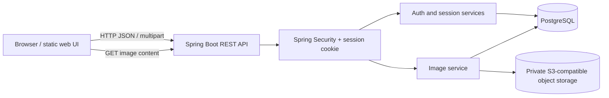
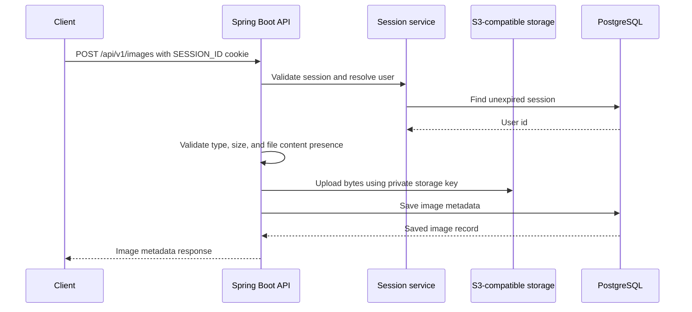
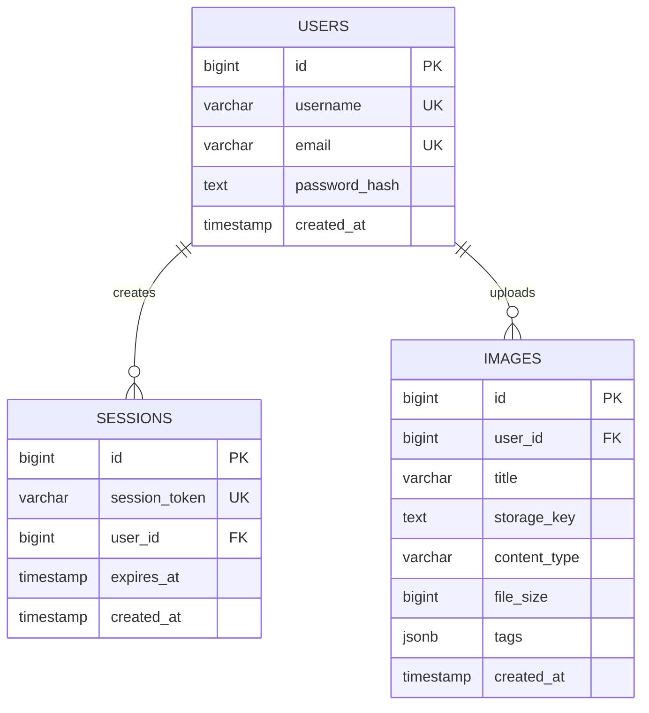

# Image Upload Service

A Spring Boot service for authenticated image uploads backed by PostgreSQL metadata and private
S3-compatible object storage. The service validates image files, stores them under user-scoped
object keys, persists metadata, and serves image content through the application without exposing
the storage provider URL.

## Highlights

- User registration with username and email uniqueness checks.
- Password hashing with BCrypt.
- Stateless Spring Security configuration with opaque database-backed sessions.
- HTTP-only session cookie authentication with 24-hour expiry.
- Multipart image upload endpoint with JPEG, PNG, and WebP validation.
- Maximum upload size of 10 MB per image.
- PostgreSQL metadata storage using Spring Data JDBC.
- Private S3-compatible object storage using the AWS SDK v2.
- User-scoped storage keys such as `users/{userId}/{uuid}.jpg`.
- Image content streaming through an application endpoint.
- Consistent validation and application exception types.
- Static HTML/CSS pages served by the same Spring Boot application.
- Docker multi-stage build for a Java 25 runtime image.

## Architecture



### Upload flow



## Database architecture



The database schema is defined in [`src/main/resources/schema.sql`](src/main/resources/schema.sql).
Foreign keys use cascading deletion for a user’s sessions and image metadata. Image bytes must be
deleted from object storage as part of image lifecycle management.

## Technology stack

### Application

- Java 25
- Spring Boot 4.1
- Spring Web MVC
- Spring Security
- Spring Data JDBC
- Spring Bean Validation
- Lombok

### Data and storage

- PostgreSQL
- AWS SDK for Java v2 S3 client
- Backblaze B2 S3-compatible endpoint by default

### Testing and delivery

- Maven Wrapper
- Spring Boot test starters
- Docker multi-stage builds
- Static HTML and CSS frontend served from `src/main/resources/static`

## Current API

The implemented controllers expose these endpoints under `/api/v1`:

| Method | Endpoint | Auth | Description |
| --- | --- | --- | --- |
| `POST` | `/auth/register` | No | Register a user |
| `POST` | `/auth/login` | No | Authenticate and create a session cookie |
| `POST` | `/images` | Session cookie | Upload an image |
| `GET` | `/images/{imageId}/content` | No | Stream stored image content |

### Register

```http
POST /api/v1/auth/register
Content-Type: application/json
```

```json
{
  "username": "jane",
  "email": "jane@example.com",
  "password": "securePassword123"
}
```

The username and email must be unique. Passwords are never stored in plain text.

### Login

```http
POST /api/v1/auth/login
Content-Type: application/json
```

```json
{
  "email": "jane@example.com",
  "password": "securePassword123"
}
```

On success, the server returns an HTTP-only `SESSION_ID` cookie. The session token is opaque,
cryptographically random, stored in PostgreSQL, and valid for 24 hours.

### Upload an image

```http
POST /api/v1/images
Content-Type: multipart/form-data
Cookie: SESSION_ID=<session-token>
```

Form fields:

| Field | Required | Description |
| --- | --- | --- |
| `file` | Yes | JPEG, PNG, or WebP image up to 10 MB |
| `title` | No | Optional trimmed image title |

The service first uploads the bytes to private object storage and then saves the metadata in
PostgreSQL. If metadata persistence fails, it attempts to remove the uploaded object.

### Get image content

```http
GET /api/v1/images/{imageId}/content
```

The server retrieves the object and returns the original media type and bytes. The storage key and
provider URL are not exposed to the client.

## Security model

- BCrypt password hashing with strength 12.
- Opaque session IDs instead of JWTs.
- Sessions are stored server-side and checked for expiration on every protected request.
- Session cookies are HTTP-only, `SameSite=Lax`, and marked `Secure` by the current configuration.
- Spring Security disables form login and HTTP Basic authentication.
- Only explicitly permitted public routes are accessible; denied routes are rejected by default.
- Image storage keys are scoped to the authenticated user.
- Input validation rejects missing files, empty files, unsupported media types, and files over 10 MB.

Before production deployment, verify the cookie `Secure` behaviour matches the HTTPS deployment
topology and add CSRF protection if browser state-changing requests are expanded beyond the current
API surface.

## Project structure

```text
image-upload-service/
├── src/main/java/net/hyf/image_upload_service/
│   ├── config/              Security, storage, and web configuration
│   ├── controller/          REST endpoints
│   ├── dto/                 Request and response objects
│   ├── exception/           Domain exceptions and global error handling
│   ├── model/               User, session, and image models
│   ├── repository/          Spring Data JDBC repositories
│   ├── security/            Authentication integration points
│   └── service/             Authentication, image, session, and storage workflows
├── src/main/resources/
│   ├── schema.sql           PostgreSQL schema
│   ├── application.yaml     Environment-backed configuration
│   └── static/               Login and home web pages
├── src/test/                 Application and service tests
├── docs/API.md               Detailed API design and endpoint reference
├── Dockerfile                Multi-stage production container build
├── pom.xml                   Maven dependencies and plugins
└── mvnw                      Maven Wrapper
```

## Local development

### Prerequisites

- Java 25
- PostgreSQL
- Git

### Configure the database

Create a PostgreSQL database and set these variables in your shell or deployment environment:

```bash
export DB_URL='jdbc:postgresql://localhost:5432/image_upload_service'
export DB_USERNAME='postgres'
export DB_PASSWORD='change-me'
```

Configure the S3-compatible storage values as well:

```bash
export B2_ENDPOINT='https://s3.eu-central-003.backblazeb2.com'
export B2_REGION='eu-central-003'
export B2_BUCKET_NAME='your-private-bucket'
export B2_KEY_ID='your-key-id'
export B2_APPLICATION_KEY='your-application-key'
```

Do not commit credentials, private keys, database passwords, or production bucket names.

### Run the application

```bash
./mvnw clean spring-boot:run
```

The application starts on port `8080` by default. Open the static home page at
[http://localhost:8080](http://localhost:8080).

### Run tests

```bash
./mvnw test
```

## Docker

Build the image:

```bash
docker build -t image-upload-service .
```

Run it with environment variables:

```bash
docker run --rm -p 8080:8080 \
  -e DB_URL='jdbc:postgresql://host.docker.internal:5432/image_upload_service' \
  -e DB_USERNAME='postgres' \
  -e DB_PASSWORD='change-me' \
  -e B2_BUCKET_NAME='your-private-bucket' \
  -e B2_KEY_ID='your-key-id' \
  -e B2_APPLICATION_KEY='your-application-key' \
  image-upload-service
```

The Dockerfile compiles the application in an Eclipse Temurin Java 25 builder image and runs the
resulting jar in a smaller Java 25 runtime image.

## Roadmap

The repository contains scaffolding and documentation for features that are not yet fully wired
into the current controllers, including logout/me endpoints, image listing and deletion, public
image discovery, search, and AI-generated tagging. These should be implemented behind dedicated
controllers and services before being advertised as production capabilities.

The detailed endpoint reference is available in [`docs/API.md`](docs/API.md); keep it synchronized
with the controller layer as the API evolves.

## License

No explicit license is currently declared in `pom.xml`. Add a project license before distributing
the service publicly.
